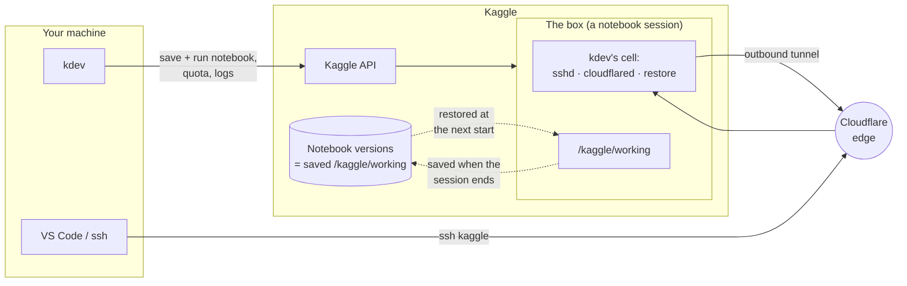
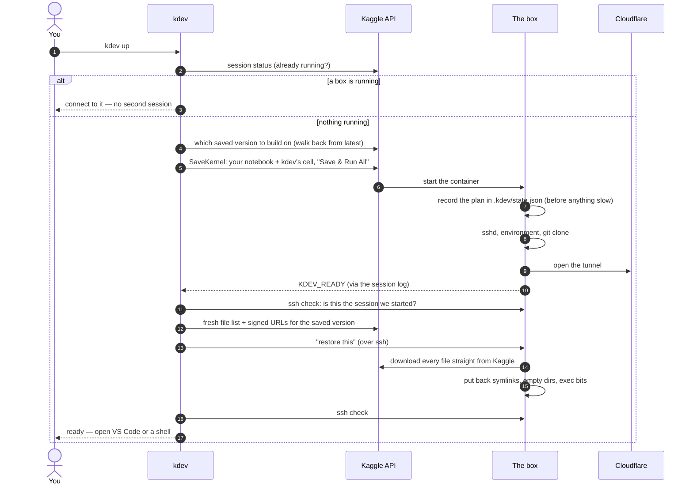
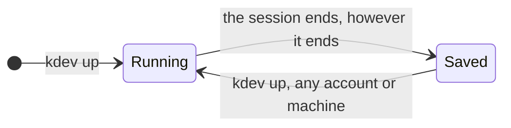
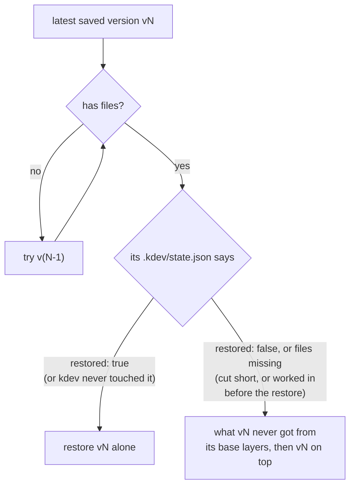
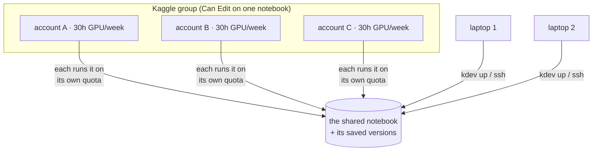
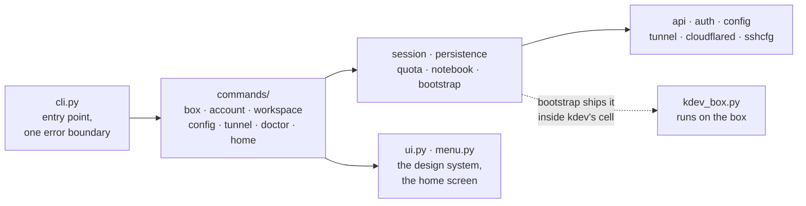

# How kdev works

This is the technical companion to the [README](../README.md): how kdev turns a
Kaggle notebook into a remote dev box, how your files survive between
sessions, how several accounts and machines share one box, the security model,
and how the code is laid out. The same material, with drawn diagrams, is on the
website at [kdev-cli.pages.dev/docs/how-it-works](https://kdev-cli.pages.dev/docs/how-it-works/).

- [The big picture](#the-big-picture)
- [What `kdev up` does](#what-kdev-up-does)
- [Your files](#your-files)
- [Picking the version to restore](#picking-the-version-to-restore)
- [Several accounts, several machines](#several-accounts-several-machines)
- [Security and limits](#security-and-limits)
- [How the code is laid out](#how-the-code-is-laid-out)

---

## The big picture

Kaggle's API can save a notebook and run it, but it has no "give me a shell"
call. kdev writes a small cell at the top of your notebook. When Kaggle runs
that cell, it turns the container into an SSH server and connects it to your
Cloudflare tunnel. Your laptop then reaches it by name.



Nothing listens on a public port: the box dials *out* to Cloudflare, and your
`ssh` reaches it through Cloudflare by hostname.

The box reports back through its own session log: `KDEV_STAGE` lines drive the
progress board, `KDEV_READY` carries the hostname, `KDEV_ALIVE` is a heartbeat
with the seconds left, and `KDEV_DONE` marks the end.

### The tunnel

With a domain on Cloudflare (free plan, domain showing *Active*),
`kdev tunnel setup` opens a browser once to authorise your Cloudflare account,
then creates the tunnel and its DNS record and stores the credentials. There's
nothing to configure in the Zero Trust dashboard. Re-running it is a no-op; it
never repoints a hostname that belongs to something else without asking.

|  | Named tunnel (your domain) | Quick tunnel (no domain) |
|---|---|---|
| Setup | once, ~2 minutes | none |
| Hostname | the same forever | new every session |
| After a network drop | same name, `ssh` just reconnects | new name; `kdev up` finds it |
| Speed | identical | identical |

### The workspace

A Kaggle group can't own anything, so one account owns the notebook and shares
it with the group as **Can Edit** (`kdev workspace create --group <slug>`, once);
everyone else runs `kdev workspace join`.

---

## What `kdev up` does



kdev verifies over ssh that the tunnel reaches the session it started before
it restores anything, and checks ssh once more before it calls the box ready.
The board you watch while this happens shows each step's own clock, so a slow
queue looks like a queue and not a hang.

### Your own cells in the notebook

kdev's cell sits on top, and **nothing below it runs**. When a session ends,
later cells are blanked for that run, so a training cell can't start after
`kdev down` and use quota. Your cells stay in the notebook, untouched.

---

## Your files

`/kaggle/working` behaves like a disk that is always there.

**Kaggle saves it.** When a "Save & Run All" session ends, Kaggle keeps
`/kaggle/working` as that version's output — and it does so however the
session ends. A clean exit, a crash and a cancel were all measured to save
every file up to the moment the container stopped. Older versions stay
readable (`v1`, `v2`, …), and they belong to the **notebook**, not to an account.

**kdev puts it back.** Kaggle starts every batch session with an empty
`/kaggle/working`; its "Persistence" setting only covers the web editor. So
each `kdev up` works out which saved version you left off at, and the new box
downloads it before you connect.



| how the last session ended | what the next `kdev up` gives you |
|---|---|
| `kdev down` | everything |
| `kdev down`, then `kdev up` straight away | everything: `up` waits for the save first (about 2 min per GB) |
| **Stop session** in the Kaggle UI | everything (a cancel still saves) |
| the session's time ran out | everything (the box stops itself 2 min early) |
| the tunnel process died | everything |
| the box crashed | everything, up to the crash |
| your laptop or network dropped | the box is still running: `kdev up` connects to it |
| Kaggle's machine itself failed | not testable; a git remote covers it |

### What kdev adds on top of Kaggle

Kaggle's saved output keeps every regular file — thousands of them, dotfiles,
`.git`, large binaries. It **drops symlinks and empty directories, and loses
executable bits**, which would break a Python virtualenv. The box records
those in `.kdev/meta.json` every 30 seconds, and the restore puts them back.

The files under `/kaggle/working/.kdev/`:

| file | what it holds |
|---|---|
| `state.json` | the plan for this session (which versions to restore), written before anything slow, and whether the restore finished |
| `meta.json` | symlinks, empty directories and executable bits, refreshed every 30 seconds |
| `fetched` | every file the restore delivered, logged as it lands |
| `authorized_keys` | the SSH key of every machine that has used the workspace |

### Backups and git

- With `git-remote` set, the box clones the repo at boot, commits and pushes
  every 15 minutes, and once more at teardown. It is the one copy that survives
  a failure of Kaggle's machine itself.
- `kdev backup` copies the running box's `/kaggle/working` to this machine.
  It is optional, since Kaggle keeps your files anyway; push it back with
  `kdev restore --from-backup`.

### Files made in the Kaggle web editor

The editor's interactive session is the one place kdev can't reach: its files
only reach the API when a version is saved. Kaggle describes Quick Save as
saving the notebook "as displayed", which isn't a clear promise to save the
working directory, so check with `kdev workspace files`. Everything made
through kdev is covered.

---

## Picking the version to restore



A version with no files is a source-only save (group setup, a Quick Save), so
kdev walks past it. A session that was stopped before its restore finished —
or that you worked in before restoring — is not skipped: it gets stacked on
the versions it was meant to be built on, so nothing done in it is lost. The
layers underneath fill in only what that session's restore never delivered
(the box logs each file as it lands, in `.kdev/fetched`), so a file you deleted
there stays deleted.

The box downloads every file itself, straight from Kaggle's signed URLs, so
your laptop only sends the plan. A restore never overwrites a file written in
the current session, so it is safe to run again at any time:

```bash
kdev restore               # finish or repeat the restore on the running box
kdev restore --from v12    # add files v12 has that the box doesn't (not a rollback)
kdev workspace files       # what `kdev up` would restore (--version v12 for another)
kdev backup                # optional: an exact copy of the box on this machine
```

---

## Several accounts, several machines



- **Quota is per account.** A session is charged to the account that starts
  it, not to the notebook's owner (measured).
- **Switching is a question, not a wall.** If the active account can't finish
  the session you asked for, `kdev up` shows every account's remaining hours
  and lets you pick. `kdev account use <name>` switches by hand.
- **The box is still running?** `kdev up` from any account or machine
  connects to it instead of starting a second one.
- **A new laptop.** `kdev setup` signs you in and joins the workspace. The
  tunnel and git settings come from the notebook, and the new laptop's SSH
  key is saved in the workspace (`.kdev/authorized_keys`). So every machine
  that has used it can reach every later box.
- **Stopping a box someone else started.** Kaggle only lets the account that
  started a session cancel it. When the box doesn't answer, `kdev down` finds
  out which account that was and cancels as it — or tells you which account
  has to.

```bash
kdev account add alice    # sign an account in (browser); re-run to refresh it
kdev account              # every account and its GPU/TPU hours left
kdev account use alice    # it runs the next box
```

---

## Security and limits

- **Access** is public-key SSH only; password login is disabled. The box
  accepts every key saved in the workspace's `.kdev/authorized_keys`: remove a
  line there to revoke a machine.
- **Secrets in the notebook.** Kaggle has no API for notebook Secrets, so the
  tunnel credentials (and a git deploy key, if you set one) sit in the private
  notebook's source. Anyone with Can Edit can read them. Scope a deploy key to
  one repository.
- **Host keys.** Every session is a new container with a new host key, so the
  `kaggle` block in `~/.ssh/config` doesn't pin one; a pinned key would break
  VS Code on every other machine. Only a box holding the workspace's tunnel
  credentials can answer on that hostname, and anyone holding those can
  already edit the notebook that builds the box.
- **Simultaneous starts converge on one box.** If several machines run
  `kdev up` together, the lowest live notebook version wins. Each losing
  client stops its own run as the account that started it, waits for the
  cancellation to finish, then connects to the winner. Status, logs and stop
  commands find that winner even when a cancelled version is newer. Startup
  verifies the SSH session before restoring files; cancelled contenders do
  not replace the winner's saved workspace. Their output remains available
  through `kdev restore --from vN`. If Kaggle cannot confirm a cancellation,
  kdev reports the run to stop and does not declare the shared tunnel ready.
- **Metadata in the last 30 s.** After a hard kill, symlinks, empty folders and
  executable bits created in the final 30 seconds are gone. File contents never
  are.
- **Nothing sensitive in crash reports.** kdev never prints tracebacks with
  local variables; `-v` shows a traceback when you ask for one.
- **Local settings** live in `~/.config/kdev/config.json` (mode 0600), with
  one Kaggle OAuth credential per account beside it; `KDEV_CONFIG_DIR` moves
  them. `kdev config` never shows secrets.
- **Kaggle's limits:** 12h per CPU/GPU session and 9h on TPU; weekly GPU/TPU
  quota per account; 20 GB of `/kaggle/working` saved per version.
- **Kaggle's terms.** Kaggle allows one account per person, and restricts
  tunnelling out of notebooks; accounts have been banned for both. kdev does
  nothing to hide what it does. Know the rules you are working under.

To report a vulnerability, follow [SECURITY.md](../SECURITY.md).

---

## How the code is laid out



| layer | rule |
|---|---|
| `commands/` | parse arguments, call logic, render with `ui`; no API calls of their own beyond reads |
| `session`, `persistence`, `quota`, `notebook` | the behaviour; testable without a terminal |
| `kdev_box.py` | standard library only; it's shipped into the container and runs there |
| `ui.py` | every visual element, with its tokens and rules written down at the top |
| `menu.py` | the home screen: an inline prompt_toolkit app whose facts load on threads while it is already usable; each item knows the command it runs |
| `errors.KdevError` | every failure a user can act on: a message and the command that fixes it |

Tests are split by module. `tests/test_cli.py` runs every command through
the real entry point against a fake Kaggle. `tests/test_kdev_box.py` runs the
on-box restore against a temporary directory.

For how to set up, test and send a change, see [CONTRIBUTING.md](../CONTRIBUTING.md).
